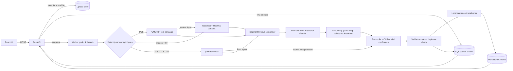
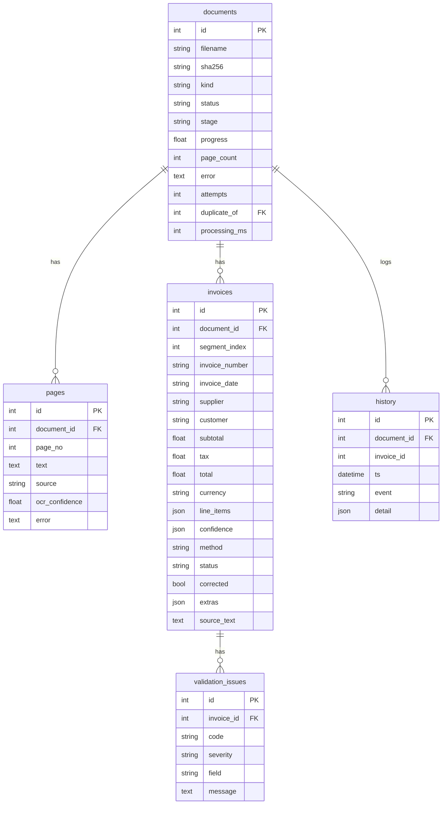

# Architecture

## Processing pipeline
1. **Upload** - stream to disk with size limit, SHA-256; identical files are linked as `duplicate` and not re-processed.
2. **Read** (0-60% progress) - digital text / OCR / spreadsheet parse; each page isolated so one failure doesn't abort the file.
3. **Segment + extract** (60-90%) - one record per invoice; LLM calls run in parallel for large files.
4. **Validate + index** (90-100%) - rules and duplicate detection (serialised by a lock so it is race-free); invoice rows stay in SQL and embeddings are upserted into persistent Chroma.
5. **Status** - `completed` (all checks pass) or `needs_review`; unreadable files `failed` with a reason and can be reprocessed.

## Design decisions
- **FastAPI/Python** over NestJS: the OCR/PDF/data stack is Python; one runtime, fewer moving parts.
- **DB-backed jobs + thread pool** over Redis/BullMQ: zero infrastructure, survives restarts (`recover()`); `enqueue()` is the single seam to swap in Celery/RQ.
- **Rules + Gemini, not LLM-only**: rules are free, offline and deterministic; optional Gemini extraction adds robustness on unseen layouts; disagreement => human review.
- **Grounding guard**: every LLM value must appear in the source text, otherwise it is discarded (never invented).
- **SQL + Chroma**: SQL remains canonical; startup reconciliation backfills existing invoice records and removes stale vectors. Chroma persists under `DATA_DIR/chroma`, with sentence-transformers running locally and hashed vectors as an optional fallback.
- **Absolute amount tolerance** (2 cents + per-line rounding): percentage tolerances hid real errors in testing.

## Database schema

Indexes: `documents.sha256/status`, `invoices.invoice_number/invoice_date/supplier/total/status`, composite `(supplier, invoice_number)`, `pages(document_id, page_no)` unique.

## Production hardening not done
Per-user auth/tenancy (only a shared API key), rate limiting, object storage (S3) instead of local disk, Alembic migrations, managed vector infrastructure for multi-host deployment, metrics/tracing, a supplier master list to catch OCR typos in names.
